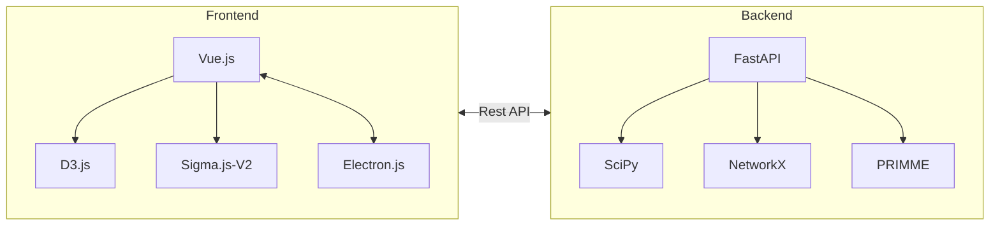
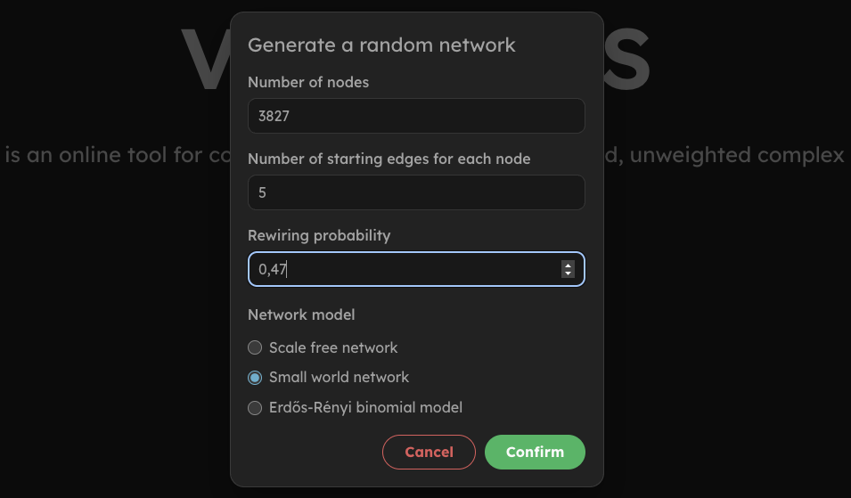
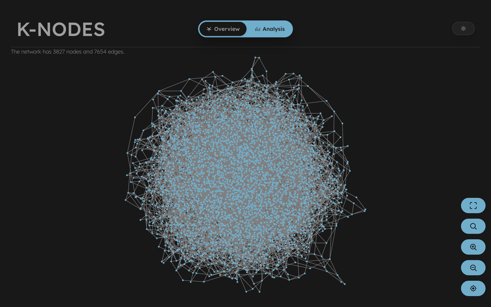
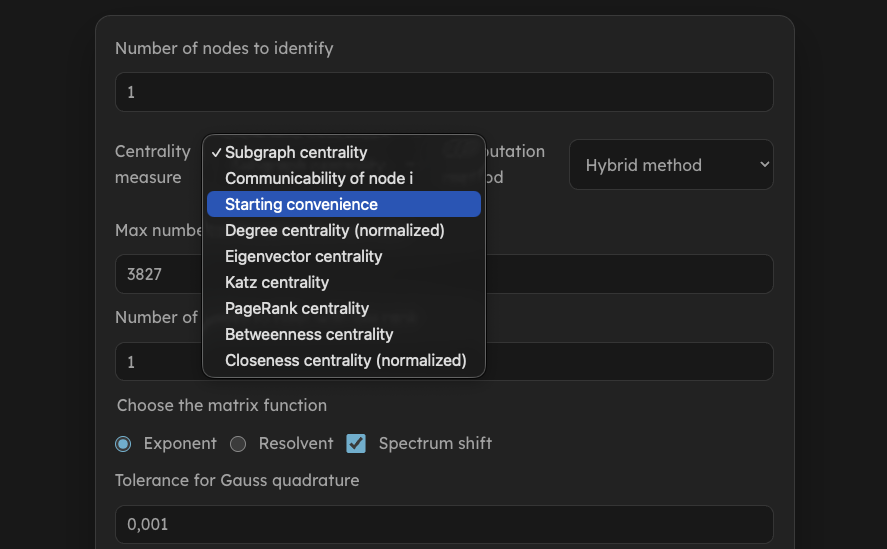
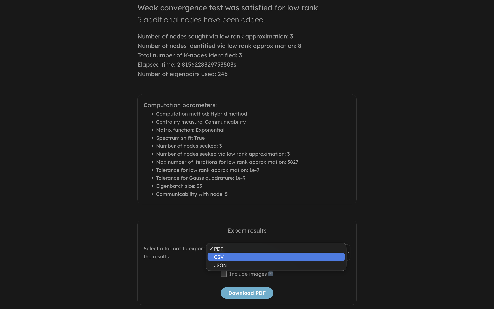
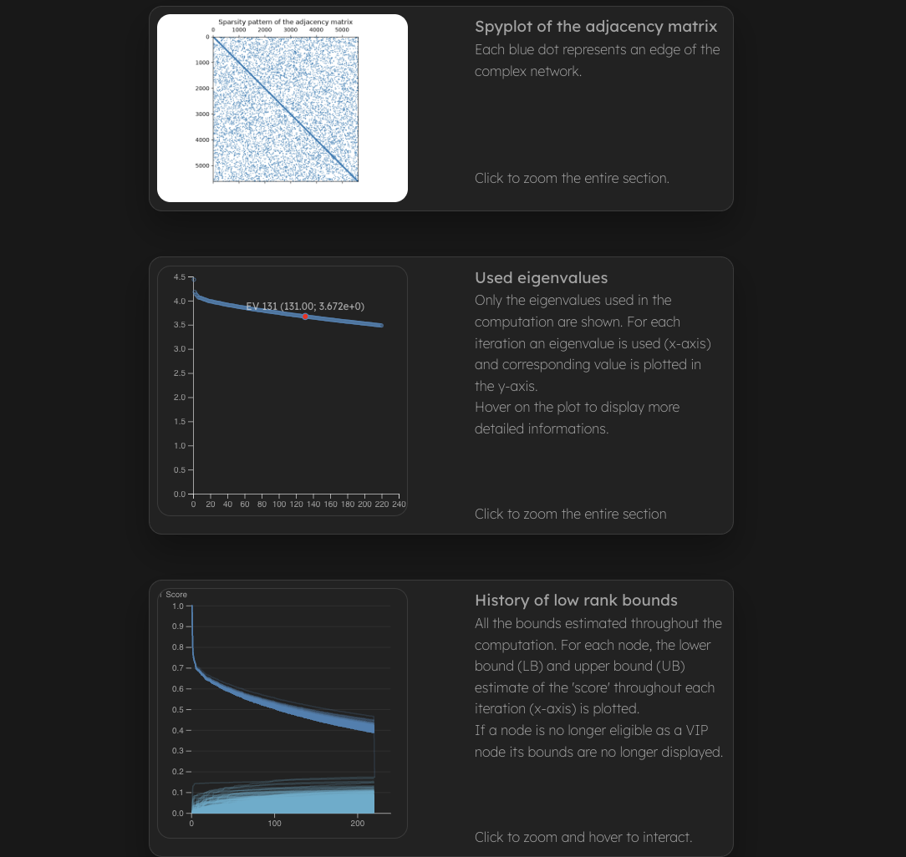

# K-NODES

 

K-NODES: Network-Oriented Detection and Selection of Key Nodes 

Caterina FENU, Danilo LECCA, and Fabio PILI

ETNA Volume XX, Pages yy-zz, year

[link](https://etna.math.kent.edu/url_available_after_acceptance)

DESCRIPTION
-----------

An online and desktop tool for complex network analysis via centrality measures computation.

Some of the key functionalities offered by K-NODES:

* Visualization of the complex network with interactive features, especially useful for topological analysis.
* Upload a network or generate a synthetic one with several models and parameters.
* Compute centrality measures with different algorithms and options.
* Explore, interact and download the results with specific functionalities.

Release: 1.0, November 2026

Programming language: Phyton 

DISCLAIMER
----------
ETNA editors have test run the code, but the reponsibility of the correctness
of the code is with the authors. ETNA is not responsible for any problems the 
code may cause; see the file License.md for details.

---

## Table of contents

* [Getting started](#getting-started)
  * [Web version](#web-version)
  * [Desktop](#desktop-version)
    * [Windows](#windows)
    * [MacOS](#macos)
    * [Linux](#linux)
* [Description](#description)
* [Usage](#usage)

## Getting started

### Web version

K-NODES is available online with the same functionalities of the desktop version.
You can visit K-NODES at [unica.it](https://unica.it).

### Desktop version

Click on [Releases](https://github.com/daniloLecca/k-nodes-desktop/releases) and download the latest version suited for your device.

***

#### Windows

##### Step 1

> [!IMPORTANT]
> Make sure to have installed Microsoft Visual C++ Redistributable.

In order to do this, run the following command in PowerShell:

```powershell
Get-ItemProperty HKLM:\Software\Microsoft\Windows\CurrentVersion\Uninstall\* | Where-Object { $_.DisplayName -like "*Visual C++*" } | Select-Object DisplayName, DisplayVersion
```

if nothing gets displayed, you can install it at [Microsoft Visual C++ Redistributable](https://learn.microsoft.com/en-us/cpp/windows/latest-supported-vc-redist?view=msvc-170). Once you installed it, restart your device.

##### Step 2

Open *K-NODES Setup 1.0.0.exe*. If a Microsoft security windows opens up, click *More info > Run anyway*.

***

#### MacOS

1. Open *K-NODES-1.0.0-arm64.dmg*
2. Move *K-NODES* to the Applications folder.
3. Eject the mounted disk image.

>[!IMPORTANT]
> Because K-NODES is an open-source project and not notarized through a paid Apple Developer certificate, macOS will
> flag it with a security warning on first launch (e.g., "K-NODES is damaged and can’t be opened" or "Apple cannot
> check it for malicious software").
> You can bypass this warning using either of the methods below.

##### Method 1: Remove the Quarantine Flag

1. Open Terminal (Cmd + Space, type Terminal, and press Enter).
2. Run the following command:

```bash
sudo xattr -cr /Applications/K-NODES.app
```

3. Type your macOS administrator password when prompted (characters will not show while typing) and press Enter.
4. Launch K-NODES normally from your Applications folder or Spotlight.

> [!NOTE]
> Note: If you moved the app to a custom folder instead of /Applications, replace the path above with the actual path
> to the app.

##### Method 2: System Settings Override

1. Try to open K-NODES once from /Applications so macOS logs the launch attempt, then close the warning dialog.
2. Open System Settings (or System Preferences on macOS Monterey and older).
3. Navigate to Privacy & Security.
4. Scroll down to the Security section.
5. You will see a notice: "K-NODES was blocked from use because it is not from an identified developer."
6. Click Open Anyway next to the notice and confirm with your admin password or Touch ID.

***

#### Linux

##### Step 1: Make the AppImage executable

Before running the application, grant execute permissions to the downloaded `.AppImage` file:

```bash

chmod +x K-NODES-1.0.0.AppImage

```

##### Step 2: Ensure Fuse2 is installed

> [!IMPORTANT]
> AppImage files require libfuse2 to mount and run. Many recent Linux distributions
> (such as Ubuntu 22.04 and newer, Debian 12, Fedora) do not include libfuse2 by
> default as they have transitioned to fuse3.

If running the AppImage produces an error related to FUSE (e.g., `dlopen(): error loading libfuse.so.2` or `AppImages require FUSE to run`), install the compatibility package:

* **Ubuntu / Debian / Mint**
  
```bash
sudo apt update
sudo apt install libfuse2
```

* **Fedora**

```bash
sudo dnf install fuse-libs
```

* **Arch Linux / Manjaro**
  
```bash
sudo pacman -S fuse2
```

##### Step 3: Run the application

Double-click K-NODES-1.0.0.AppImage or launch it from the terminal:

```bash
./K-NODES-1.0.0.AppImage
```

> [!TIP]
> If you cannot or do not wish to install `libfuse2`, you can launch the app directly
> by passing the `--appimage-extract-and-run` flag:

```bash
./K-NODES-1.0.0.AppImage --appimage-extract-and-run
```

## Description

K-NODES proposes itself as a fast, reliable and accurate alternative for network analysis providing a wide range of options for graph visualization, centrality measures computation and data interpretation.

What differentiates K-NODES from the other tools is its unique architecture. An entirely *Python-driven* stack, with the aid of NumPy, SciPy, Networkx and FastAPI, establishes an excellent solution for performing accurate scientific calculations.

The entire GUI is built on top of Vue.js and employs specific tools and libraries in order to provide great performance and high usability. For example, leveraging [Sigma.js v2](https://www.sigmajs.org/) for network visualization ensures a smooth user experience, capable of handling the visualization of hundreds of thousands of nodes.

The neat separation between *frontend* and *backend* yields the possibility to scale and maintain them independently.



## Usage

### Network input and synthetic graph generation

Different file extensions are supported. Precisely, MATLAB `.mat` files, Graphology-compatible `.json` and [GEXF](https://gexf.net) `.gexf` format.

> [!NOTE]
> MATLAB `.mat` file must contain exactly one variable representing the sparse binary adjacency matrix of the network. Non-zero diagonal entries will be mapped to zero as well as the nonpositive entries.

Alternatively, one can generate a synthetic complex network using either the Barabási–Albert, Watts-Strogatz or binomial Erdős–Rényi model, with the possibility to precisely adjust the parameters.



***

### Visualization and interaction

Topological network analysis is achievable with a dedicated dashboard:



Different interactions are supported, i.e. node dragging and degree displaying. The controls on the right support zooming, *fullscreen* mode and vertex search.

***

### Centrality computation

Different centrality measures are supported along with a wide range of options and parameters.



***

### Results diagnostics and exportation

Complete analytics are shown ranging from computation time to algorithm-specific outcomes. The prompted computation parameters are reported for a rapid evaluation of the performed experiment.



Exporting the results can be done in three different ways:

* **PDF** format: a complete document which reports computation results and parameters alongside with calculation diagnostics.
* **CSV** format: *tabular-like* file where each row reports a K-node with its  corresponding score, with descending order.
* **JSON** format: a *key-value* representation of the results, particularly useful when using data analysis tools.

> [!TIP]
> Try not including the diagnostic images from the PDF file if the download is taking too long. This often happens if many iterations of the low rank approximation algorithm were needed.

Results diagnostics comprehend a *snapshot* of the adjacency matrix sparsity pattern, evaluated eigenvalues visualization and the *low rank* bounds evaluation overview.



> [!TIP]
> Try hovering over the plots to observe additional information.
