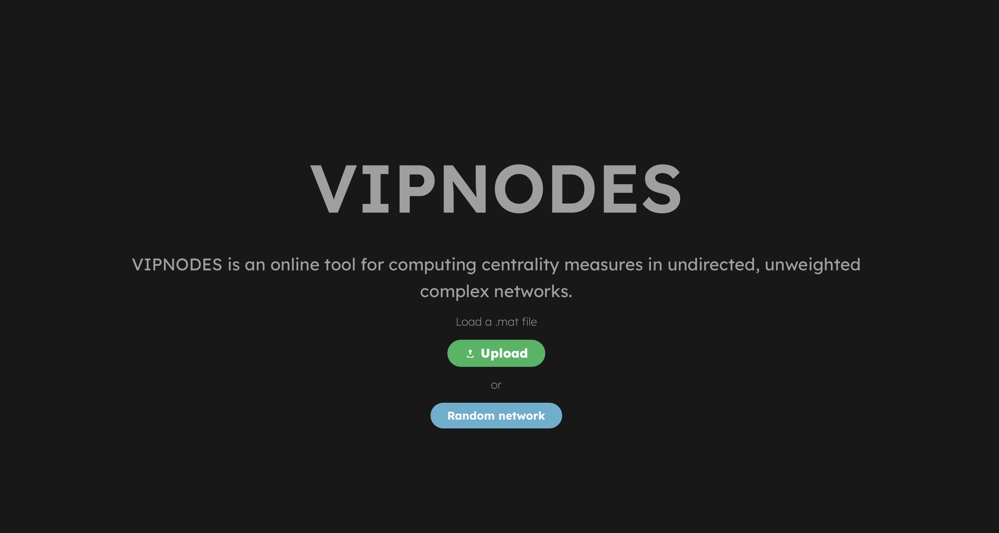
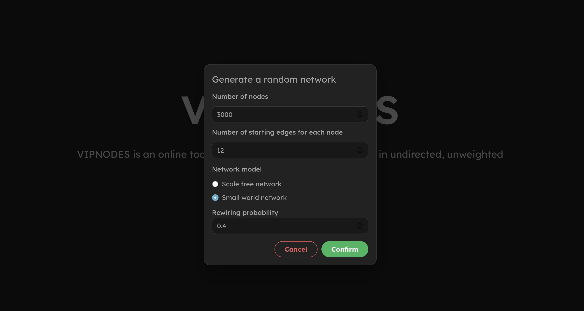
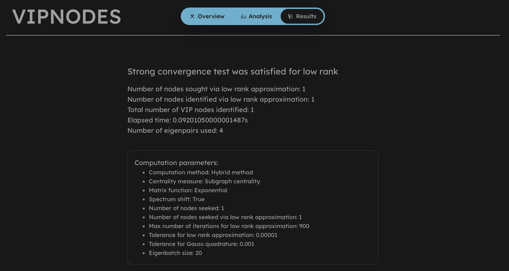
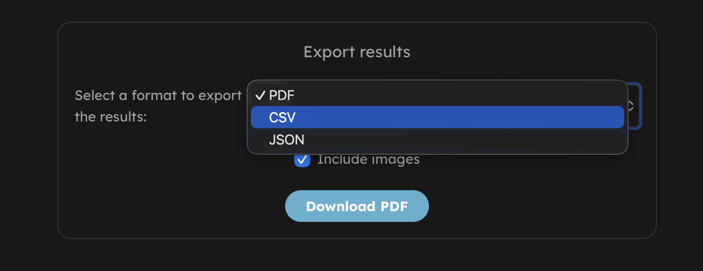
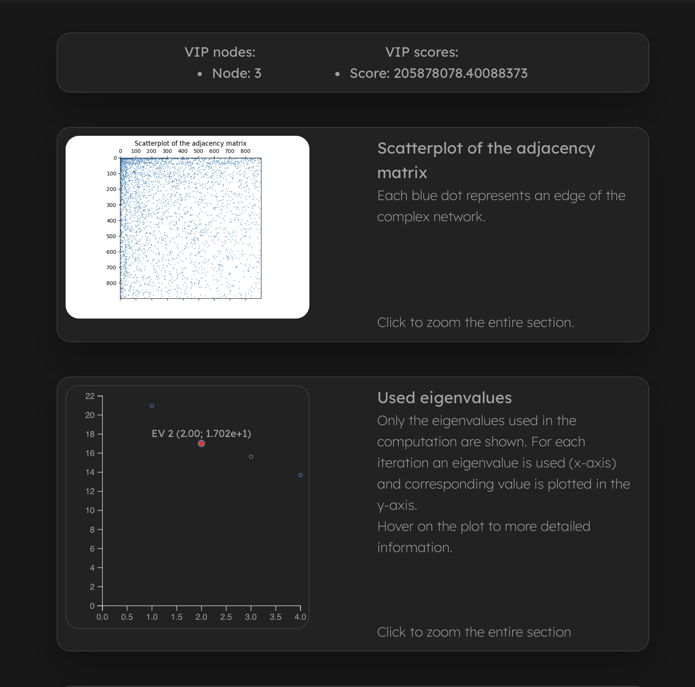
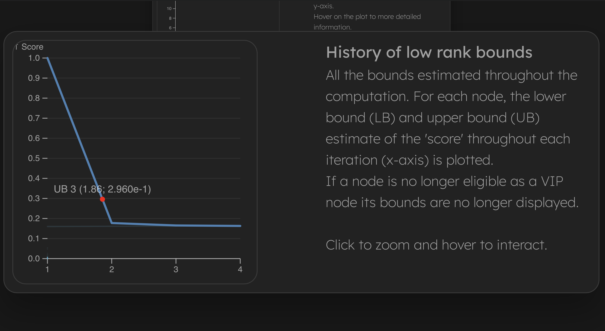

# VIPNODES

> An online tool for seeking the most important nodes of a network through the computation of centrality measures in undirected, unweighted complex networks.

## Description

This tool was created with the intent of making available the tool *VIPNODES*, which was originally developed in **MATLAB**.

These are some of the functionalities introduced in this tool:

* Analyze a complex network given the sparse adjacency matrix. Note that at the moment only *.mat* files are accepted
* Visualize the complex network. With **vipnodes** you can take a look at the entire network thanks to a force directed layout, which gives a clean and ordered visualization of the nodes and edges
* Discover the most important nodes of the complex network with some of the most interesting measures, for example:
  * Communicability of a node with entire network
  * Subgraph centrality of a node
  * Starting convenience of a node
* Exploit the most common and performing algorithms to compute these metrics via low rank approximation and Gauss quadrature
* Get statistics of the computation, *i.e.* distribution of the spectrum, bounds for a metric in a certain node and a heatmap of the adjacency matrix

The entire project is made in Vue, with the aid of Sigma.js v2 and Graphology for the visualization of the network, and the backend which processes the complex network is based on FastAPI, a popular and high-performing Python framework for backend development.

All the data working data of the web-app is stored with Redis, an high performance in-memory database. Redis stores the data with _key-value_ pairs that are going to be accessible through a token with validity of 2 hours.

Note that the database in this case is not persistent since there is no need to save the network persistently. Future versions may implement a persistent storage if needed.

## Usage

1. Upload a complex network: 
    * Using a **file** (.mat file containing the sparse adjacency matrix)
    * Generating a *scale free* or *small world* network
2. Visualize the complex network, supported interactions: 
    * Nodes dragging
    * Node clicking to show node degree
    * Zoom, unzoom or reset camera zoom 
    * Full screen visualization
3. Analyse the complex network: 
    * Navigate to `Analysis`
    * Fill out the form with your parameters
    * Compute and wait (you can even cancel the computation)
4. See the results of the computation: 

### Results

> **Observe the computation parameters and results**

* * *
### Export

> **Export the results in PDF, CSV or JSON. Do not include images if too many iterations were needed because the SVGs become too dense to export.**

* * *
### Visualize scatterplot and eigenvalues

> **Visualize which are the VIP nodes and what is their *'score'*. Observe which eigenvalues have been used, what is their value and their distribution. Scroll over the graph to zoom and click on the description of the section to zoom the entire section.**

* * *
### Observe bounds evolution

>**See the evolution of lower and upper bounds throughout the computation. Hover on the plots to see the corresponding values.**